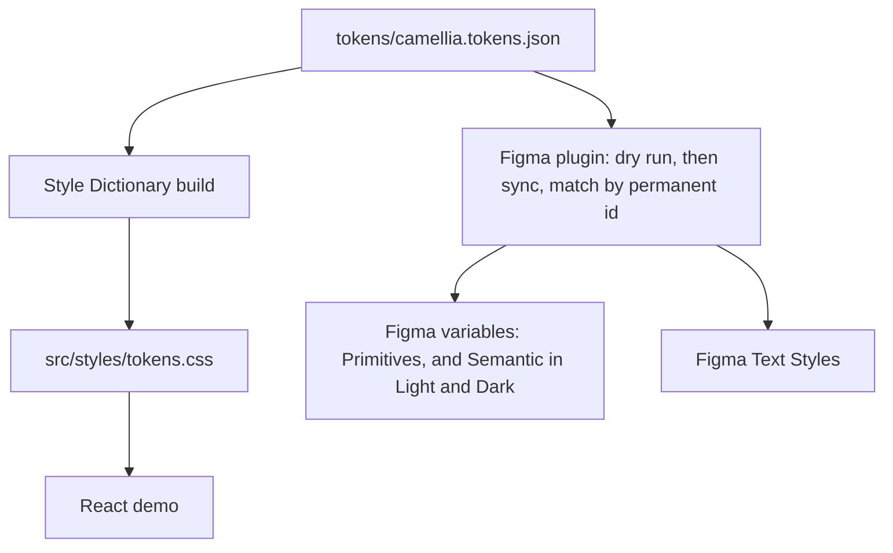

# Camellia

Camellia is CJ Huang's personal design-engineering lab. It is a design system with one token file, in the Design Tokens Community Group (DTCG) format, as the single source of truth for both CSS and Figma. It's also where CJ experiments with interaction design: small components with carefully tuned motion.

## Pipeline

`tokens/camellia.tokens.json` is the only authored source. CSS and Figma are generated from it, in one direction. When either disagrees with the JSON, the JSON wins.



`npm run tokens:css` runs Style Dictionary in `scripts/tokens/build-css.mjs` (custom format `camellia/css`) and writes `src/styles/tokens.css`. The Vite demo imports that file. The next build overwrites a hand edit.

The Figma plugin bundles the same JSON. A dry run reports what would change and writes nothing. The sync that follows finds each object by a permanent id and updates it in place. The plugin menu writes two variable collections: Primitives, and Semantic with Light and Dark modes. Text Style sync follows those same rules in `figma-plugin/src/sync-text-styles.ts`. Its tests use an in-memory stand-in, which is not a run inside Figma. The menu commands in the manifest are listed under [Figma plugin](#figma-plugin).

## Key ideas

- Tokens that sync carry a permanent id in the JSON: `prim-` for primitives, `sem-` for semantic tokens, `type-` for typography. The plugin stores that id on the Figma object and matches the id, so a rename updates the same object instead of creating a second one.
- A dry run reports what would change and writes nothing. Writing is a separate step.
- Sync is idempotent. It creates what is missing, updates the rest in place, and a second run does not create duplicates. Something that exists only in Figma is reported and left alone.
- CI rebuilds the CSS and fails if the committed stylesheet does not match the JSON. It typechecks, tests, and bundles the plugin, lints, builds the demo, and runs the guardrail tests.
- [AGENTS.md](AGENTS.md) is the rulebook for AI agents in this repo. CJ reviews pull requests and merges them. A change to that file needs CJ's approval.

## Interaction work

The first component is a proximity hex color picker: a honeycomb of Camellia color tokens. The interaction was tried in a throwaway HTML prototype outside this repo, then written down before implementation. The record is the [interaction brief](docs/components/color-picker-brief.md).

- **Proximity.** Cells near the pointer grow together, stronger when they are closer. The demo starts at scale 1.15 inside 80px, with darken off. Radius, scale, and darken are tuned from the controls beside the picker.
- **Press.** Pointer down, or Enter or Space, dips the cell to scale 0.94.
- **Selection.** An inner hexagon grows from the center on an overshoot curve. The mark is white or ice 900, whichever has more contrast with the cell.
- **Idle.** The mark breathes on a sine ease-in-out, then finishes the current breath and stops about 11 seconds after the last interaction. That auto-stop is how the motion meets WCAG 2.2.2 Pause, Stop, Hide.
- **Reduced motion.** `prefers-reduced-motion` leaves the mark static: no press dip and no breath.
- **Keyboard.** The picker is a radiogroup with one tab stop. Arrow keys move to a neighboring cell and select it, the same as a native radio. Proximity does not run from the keyboard.

## Demo

<!-- live demo link added after GitHub Pages deploy -->

Node.js 22.18 or later. `package.json` sets `engines.node` to `>=22.18.0`.

```bash
npm ci
npm run dev
```

Vite prints the local URL. The page opens on Blocks, a masonry of components. The hex color picker is the first block. Hover or focus a card to see its name and the button that opens its details. Tokens lists the generated custom properties (color, type, space, radius, shadow, and the other groups), and a button there sets `data-theme="dark"` so semantic colors follow the dark overrides. Pipeline is a short placeholder page. Text links at the top switch among the three. The page starts from the system's light or dark preference.

The font tokens name Geist and Geist Mono. The demo self-hosts those font files, so the page uses them even when the families are not installed.

## Figma plugin

`npm run figma:build` typechecks, runs the plugin tests, and writes `figma-plugin/dist/code.js`. That bundle is not committed. In the Figma desktop app, import [`figma-plugin/manifest.json`](figma-plugin/manifest.json) through Plugins → Development. The Figma browser app cannot load a local plugin.

The manifest menu is:

- Inventory (read-only)
- Sync Primitives — dry run
- Sync Primitives
- Sync Semantic — dry run
- Sync Semantic
- Sync Text Styles — dry run
- Sync Text Styles

`Sync Text Styles — dry run` writes nothing. `Sync Text Styles` creates or updates the 13 text styles. Plugin tests run against an in-memory stand-in. A passing test is not a run inside Figma.

## Repository

| Path | What it is |
|---|---|
| [`tokens/camellia.tokens.json`](tokens/camellia.tokens.json) | The only authored token source |
| [`src/styles/tokens.css`](src/styles/tokens.css) | Generated CSS custom properties |
| `src/` | Vite and React demo |
| [`scripts/tokens/`](scripts/tokens/) | CSS build and check |
| [`figma-plugin/`](figma-plugin/) | Camellia Figma Sync |
| [docs/roadmap.md](docs/roadmap.md) | Current status and the next task |
| [docs/camellia-design-system-v0.1.md](docs/camellia-design-system-v0.1.md) | Design intent. The JSON wins where values differ |
| [docs/token-pipeline-roadmap.md](docs/token-pipeline-roadmap.md) | Pipeline phases and decisions |
| [docs/components-roadmap.md](docs/components-roadmap.md) | Components and interactions |
| [docs/verification.md](docs/verification.md) | What each check proves and does not prove |
| [AGENTS.md](AGENTS.md) | Rules for AI agents |

## Commands

| Command | What it does |
|---|---|
| `npm run dev` | Local demo, at the URL Vite prints |
| `npm run tokens:build` | Generate `src/styles/tokens.css`, then validate it |
| `npm test` | Figma plugin tests |
| `npm run figma:build` | Typecheck, test, and bundle the plugin |
| `npm run lint` | ESLint on `.js` and `.jsx` |
| `npm run build` | Production build in `dist/` (not committed) |

## Status

What is done, and what is next, is in [docs/roadmap.md](docs/roadmap.md).
